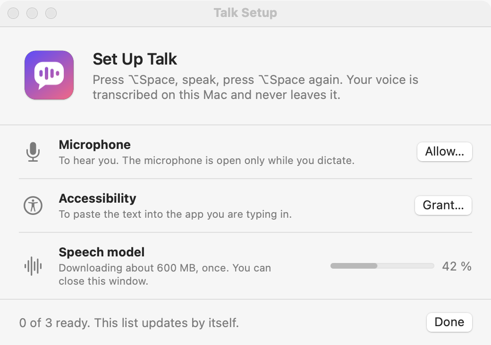
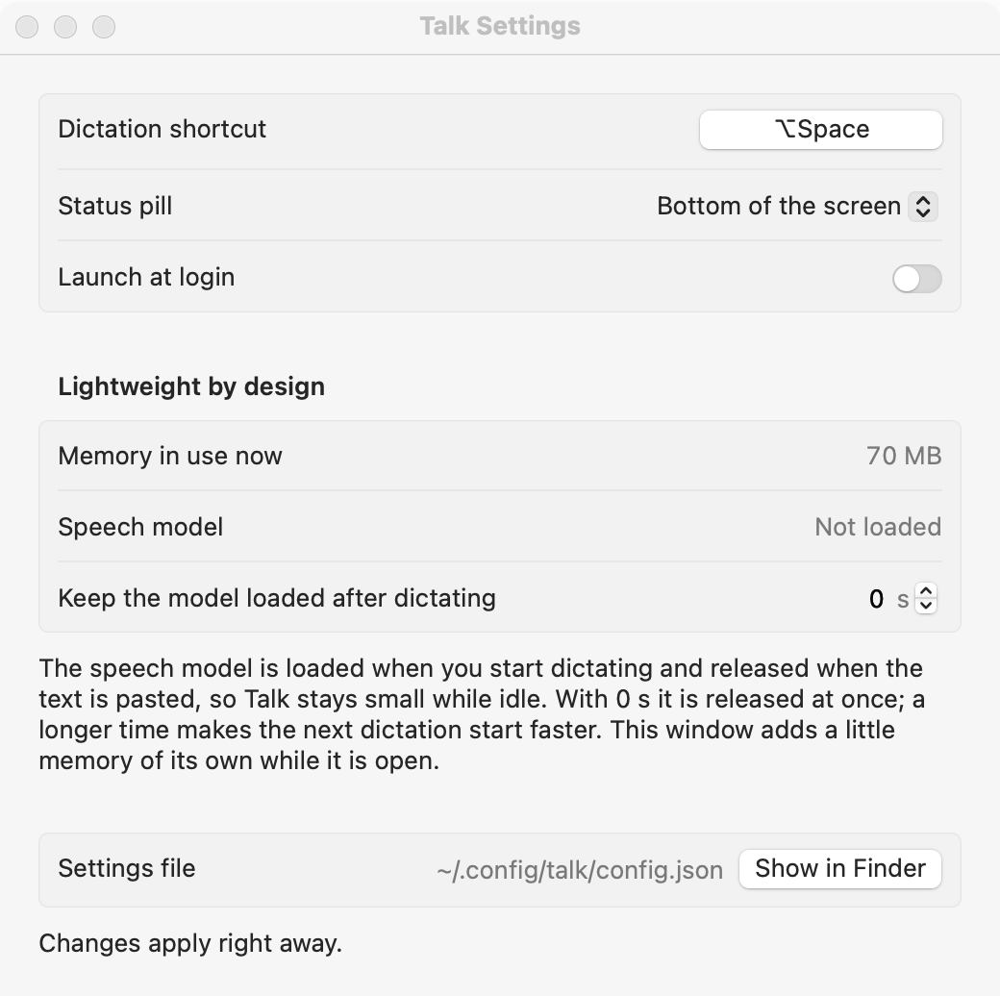

# Talk

**Private, lightweight dictation for macOS.** Press **⌥Space**, speak, press **⌥Space** again: your words are
typed into whatever app you're using. Speech recognition runs entirely on your Mac's Neural Engine — no account,
no cloud, nothing leaves your computer.

[](https://github.com/ivancaas/talk/actions/workflows/ci.yml)


[](LICENSE)

<p align="center">
  
  
</p>

## Features

- **One shortcut, any app.** Dictate into Mail, Slack, your editor, a browser — anywhere you can type.
- **Fully local.** [Parakeet TDT 0.6B v3](https://huggingface.co/nvidia/parakeet-tdt-0.6b-v3) on the Neural
  Engine via [FluidAudio](https://github.com/FluidInference/FluidAudio). Works offline after the first download.
- **25 languages, detected automatically** — English, Spanish, French, German, Italian, Portuguese and most other
  European languages, with punctuation and capitalisation.
- **Fast.** A 3-second sentence is transcribed in about 0.1 s, a minute of speech in about 0.6 s.
- **Tiny when idle.** See [Lightweight by design](#lightweight-by-design).
- **Guided setup.** A Setup window checks the microphone, Accessibility and the speech model, and shows you how
  to fix whatever is missing.
- **Command-line transcription.** `talk transcribe` turns audio, video or a video URL into text, SRT/VTT
  subtitles or timed JSON.

## Lightweight by design

Local dictation apps usually keep their speech model in memory all day. Talk doesn't:

- The model runs in a small helper process that starts **when you start speaking** and loads the model while
  you talk (about a third of a second), so you don't wait for it.
- The helper **exits as soon as the text is pasted**, which hands every byte of the model's memory, including
  the Neural Engine's copy, straight back to macOS.
- The microphone is open **only while you dictate**. No windows, timers or background work while idle.

Measured on a MacBook Pro (M1 Pro, 32 GB, macOS 15.8):

| | Talk |
|---|---|
| Memory while idle (Activity Monitor) | **≈ 10 MB** (28 MB resident) |
| Memory after a dictation | back to idle the moment the text is pasted |
| App size | 20 MB (+ 600 MB model, downloaded once) |
| Start helper + load model | ≈ 0.3 s, overlapped with your speech |
| Transcribing a 3 s / 60 s dictation | ≈ 0.1 s / 0.6 s |
| `talk transcribe`, 98 s recording | 1.3 s total, 65 MB peak |

Settings → *Lightweight by design* shows Talk's live memory use. If you dictate often and want the next
dictation to start instantly, *Keep the model loaded after dictating* trades memory for speed.

## Install

Requirements: Apple Silicon Mac (M1 or later), macOS 14 Sonoma or later, Xcode 16+ or the Command Line Tools
(`xcode-select --install`).

```bash
git clone https://github.com/ivancaas/talk.git
cd talk
scripts/build.sh            # builds, signs and installs /Applications/Talk.app
open /Applications/Talk.app
```

Talk lives in the menu bar (no Dock icon). On first launch the **Setup** window walks you through:

1. **Microphone** — to hear you.
2. **Accessibility** — to paste the text into the app you're typing in.
3. **Speech model** — a one-time ~600 MB download, with progress.

> **What `scripts/build.sh` does to your Mac:** it creates a self-signed code-signing certificate called
> "Talk Local Signing" in your login keychain (once), quits a running Talk, replaces `/Applications/Talk.app`, links
> `~/.local/bin/talk`, and links the `talk-transcribe` agent skill into `~/.claude/skills` and `~/.agents/skills`. The certificate keeps the same signature across rebuilds, so macOS remembers the
> Accessibility permission. No Apple developer account is needed.

## Usage

| | |
|---|---|
| Start / stop dictating | **⌥Space** (change it in Settings) |
| While recording | a small pill under the mouse shows *Listening* → *Transcribing…* → *Pasted* |
| Setup, Settings, About | menu-bar icon |

### Settings

Shortcut, pill position (top or bottom of the screen), launch at login, and how long to keep the model loaded.
Changes apply right away. They are stored in `~/.config/talk/config.json`:

```json
{ "hotkey": "opt+space", "pill": "bottom", "unloadAfterSeconds": 0 }
```

`hotkey` accepts combinations like `ctrl+opt+d`, `cmd+shift+space` or `f13`.

### Transcribe files from the command line

```bash
talk transcribe meeting.m4a                       # plain text, paragraphs at long pauses
talk transcribe -t lecture.mp4                    # one line per sentence with [hh:mm:ss]
talk transcribe -f srt -o video.srt video.mov     # subtitles (also vtt, json; -w adds word timings)
talk transcribe -f json -d out/ *.mp3             # one file per input
talk transcribe "https://www.youtube.com/watch?v=..."
```

- Reads anything AVFoundation opens (wav, mp3, m4a, aac, flac, aiff, mp4, mov…). mkv, webm, ogg and opus need
  `ffmpeg`; URLs need `yt-dlp` (both via Homebrew).
- Text goes to stdout and progress to stderr (`-q` silences it). Exit code 1 if any input failed.
  Made for scripts and AI agents: `talk transcribe --help` lists every option.
- **For AI agents:** `scripts/build.sh` installs a `talk-transcribe` skill inside `Talk.app` and links it from
  `~/.claude/skills` and `~/.agents/skills`, so Claude Code and other agents know how to use the CLI.
- macOS ships an unrelated `/usr/bin/talk`. If it comes first on your `PATH`, call `~/.local/bin/talk`, or put
  `~/.local/bin` first.

## Accuracy

Word error rate on 243 clips (LibriSpeech test-clean/other, Multilingual LibriSpeech Spanish, plus long, quiet,
noisy and loud variants):

| Set | WER |
|---|---|
| English, clean + hard | 2.5 % |
| Spanish | 2.9 % |
| Long dictation, 25–45 s | 2.4–3.0 % |
| Quiet speech, English / Spanish | 3.3 / 3.6 % |
| Noisy speech, English / Spanish | 2.1 / 13.7 % |
| **All** | **3.7 %** |

Quiet speech is raised to a normal level before transcription, which keeps the model in the right language.
Known weak spot: in noisy Spanish recordings the model occasionally switches to English.

## Privacy

Audio is recorded only while you dictate, kept in memory, transcribed on your Mac and discarded. Talk makes no
network requests except downloading the speech model from Hugging Face on first use (and `yt-dlp` when you pass
a URL to `talk transcribe`). No analytics, no telemetry.

## Uninstall

```bash
osascript -e 'quit app "Talk"'
rm -rf /Applications/Talk.app ~/.local/bin/talk ~/.config/talk "$HOME/Library/Application Support/Talk"
rm -f ~/.claude/skills/talk-transcribe ~/.agents/skills/talk-transcribe
tccutil reset All com.ivancarracedo.talk
```

Optionally delete the "Talk Local Signing" certificate in Keychain Access.

## Development

```bash
swift build -c release    # build
swift test                # unit tests
```

The code is a single Swift package (`Sources/Talk`): `Recorder` (microphone → 16 kHz), `Level` (quiet-speech
gain), `Engine` (model load/transcribe), `ModelWorker` (runs `Engine` in a helper process
that exits after each dictation), `Paster`, `HUD` (status pill), `SetupWindow` / `SettingsWindow`
and `Transcribe` (CLI). Window design notes are in [docs/GUI.md](docs/GUI.md).

Contributions are welcome — please open an issue first for larger changes.

## License

[MIT](LICENSE) © 2026 Ivan Carracedo. Third-party components and the speech model keep their own licenses — see
[NOTICE](NOTICE). Parakeet TDT 0.6B v3 is © NVIDIA, licensed under CC-BY-4.0.
